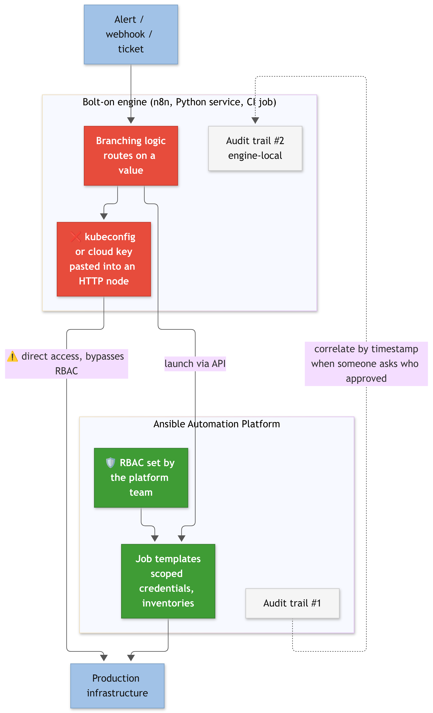
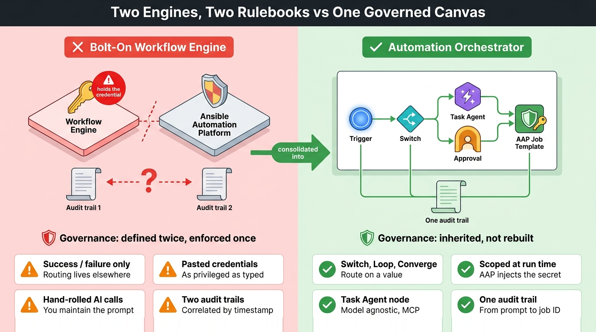
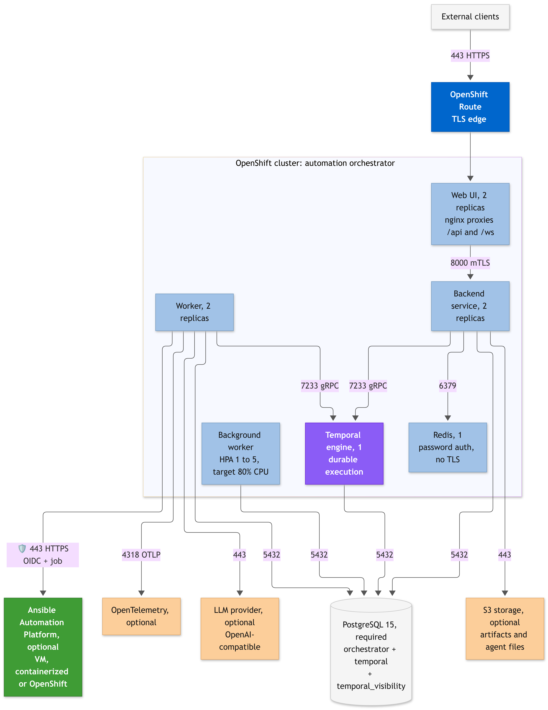
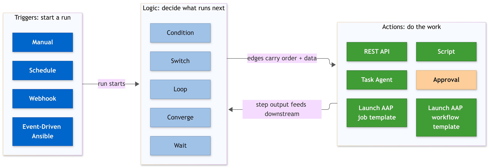
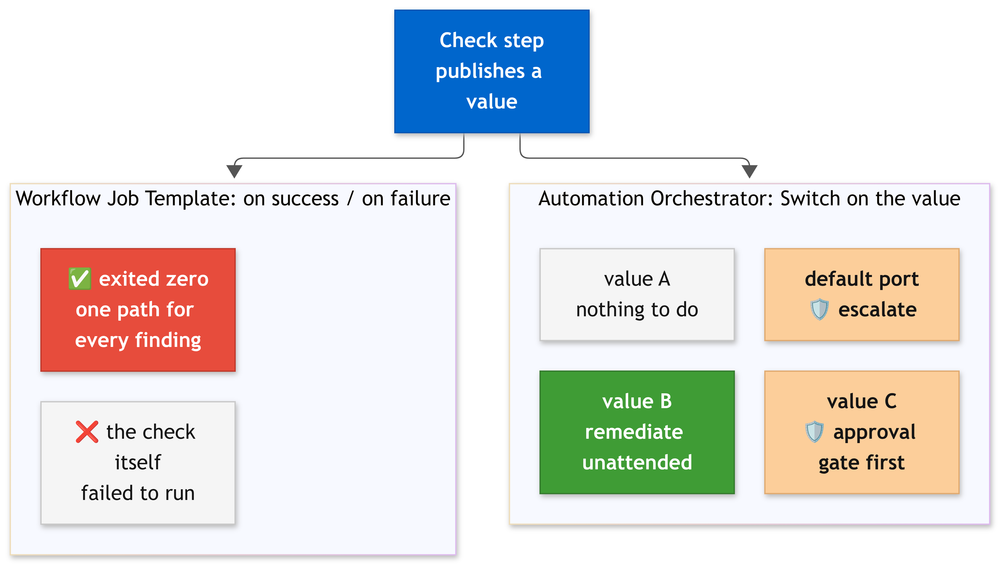
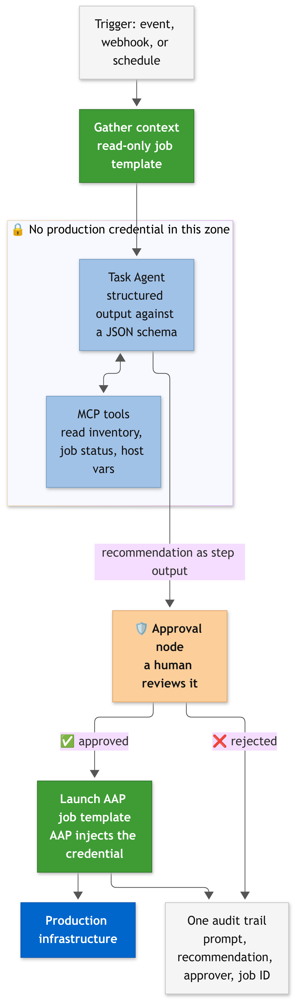
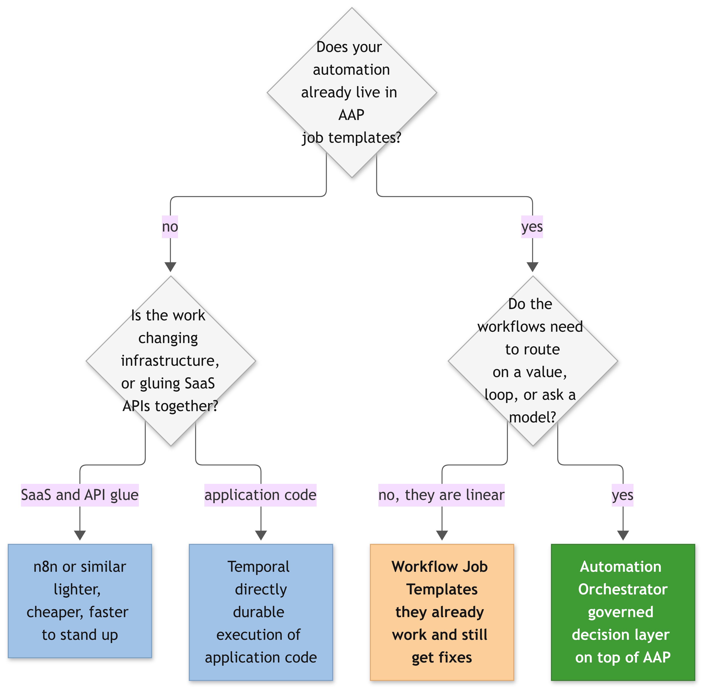

*The first post in a series on the Automation Orchestrator add-on for Red Hat Ansible Automation Platform. This one covers what it is, where it fits, and the question that decides whether you need it or a general-purpose workflow engine.*

> 🔬 **How this was written:** Everything below is my own reading from my own lab. Every product claim links to public documentation so you can check it rather than take my word for it.

If your organization runs **Red Hat Ansible Automation Platform (AAP)**, you have probably built a **Workflow Job Template** that outgrew what a Workflow Job Template can express. The graph routes on exactly three edge types: **on success**, **on failure**, and **always**. That is enough for a pipeline, and it runs out of room the moment the next step depends on *what* the previous step found rather than on whether it exited zero.

What usually happens next is a second engine. Someone stands up **[n8n](https://n8n.io/)**, an open source low-code automation tool with a drag-and-drop canvas and a few hundred SaaS connectors, to catch the webhook and post to Slack. Or a **Python service** that polls the AAP API on a timer. Or a **Jenkins** job that calls three job templates in sequence and does the branching in Groovy. It works. It also means the thing deciding what runs in production now lives outside the platform that governs production.

**Automation Orchestrator** is Red Hat's answer to that, [generally available since **21 August 2026**](https://www.redhat.com/en/blog/unify-it-workflows-scale-new-automation-orchestrator-ansible-automation-platform) as an **add-on for AAP 2.7**. This post is about what it actually does and when it earns its place, written from a lab I have been building since the product went GA.

- 🚀 **Product page:** [Red Hat Ansible Automation Platform automation orchestrator](https://www.redhat.com/en/technologies/management/ansible/automation-orchestrator)
- 🧪 **Demos and use cases:** [ansible-tmm.github.io/aap-orchestrator-demos](https://ansible-tmm.github.io/aap-orchestrator-demos/). Hands-on exploration of 18 workflows across certificate lifecycle, CVE remediation, patching, and incident triage
- 🕹️ **Interactive demo:** [Try it in the browser](https://www.redhat.com/en/interactive-demo/automation-orchestrator). Event-driven trigger, existing playbooks, AI-assisted analysis, and a human approval in one vulnerability-remediation workflow, nothing to install
- 📘 **Product documentation:** [Automation Orchestrator 2026.8](https://docs.redhat.com/en/documentation/automation_orchestrator/2026.8)
- 📺 **Video playlist:** [Automation Orchestrator on YouTube](https://www.youtube.com/playlist?list=PLRQLZQDrBAxE)
- 📣 **GA announcement:** [Unify IT workflows at scale with the new automation orchestrator](https://www.redhat.com/en/blog/unify-it-workflows-scale-new-automation-orchestrator-ansible-automation-platform)

> ⚡ **TL;DR:**
>
> **The Problem:** AAP Workflow Job Templates branch on success and failure. Anything that needs to route on a value, loop over a collection, or ask a model for a judgment ends up in a second engine, and governance forks along with it.
>
> **The Solution:** A visual workflow canvas with logic nodes, event and webhook triggers, LLM task agents, and approval gates, where your existing job templates are steps without modification.
>
> **The Impact:** One audit trail, one RBAC model, and AI recommendations that never hold the credential that changes production.

## 🚨 The problem: two engines, two sets of rules

The gap is narrower than it first sounds, so it is worth being precise about it. AAP Workflow Job Templates already do a lot. They nest, they converge, they carry **approval nodes**, and they pass **artifacts** between jobs. What they cannot do is **route on a value**.

That limitation is easy to miss because it sounds small. A check job almost always **exits zero**: it ran, it found out what it needed to find out, and it reported. Whether it found a healthy system or a broken one, the edge leaving that node looks the same. The graph can branch on whether the check *worked*, never on what it *found*, and what it found is the only thing anyone cares about.

So the branching moves somewhere else. Once it does, you own **a second credential store**, **a second RBAC model**, and **a second audit trail** that nobody reconciles with the first one. The workflow engine ends up holding a **kubeconfig** or a **cloud access key**, because that is how a generic HTTP node authenticates, and whatever was pasted into that field is the real **blast radius**.

There is a milder version of the same problem that involves no second vendor at all. **Event-Driven Ansible (EDA)** rulebooks live in one part of the platform and job templates in another. A signal arrives, a rulebook decides it matters, a job runs. That works, and it is also several objects in two places with no single view showing how the signal maps to the work it caused. When someone asks afterwards what fired and why, you reconstruct the answer instead of reading it.

## 📊 Bolt-on workflow engine vs Automation Orchestrator

Eight things change when the decision layer moves inside the platform. None of them is the canvas.

## 🧩 What is Automation Orchestrator?

It is a **visual canvas for workflows that span more than one system**. You place nodes on it, connect them, and publish. A node can **launch an AAP job template**, call a **REST API**, run a **script**, **branch on a value**, **wait for a human to approve**, or **ask a language model** for a judgment. An engine runs that graph, keeps its state durable, and records every step in **one audit trail**.

The part that matters if you already run AAP: **your existing job templates are a node type**. Nothing is converted, copied, or rewritten. The orchestrator reaches into your controller and launches them, which is why Red Hat positions it as a **layer on top of** the platform rather than a replacement for any part of it.

So the short version is three things at once: a **place to draw the workflow**, an **engine that runs it reliably**, and a **governance boundary** that the drawing cannot escape. The rest of this section is how that is put together.

It is a separate product with its own release train. The version is **`2026.8`**, not `2.7`, and it has [its own documentation set](https://docs.redhat.com/en/documentation/automation_orchestrator/2026.8). **The orchestrator itself** installs as an **operator on OpenShift Container Platform 4.14 or later**, requires an **external PostgreSQL with three databases**, and runs **[Temporal](https://temporal.io/)** underneath, an open source engine for durable execution that checkpoints every step to the database as it goes. That is what makes a run survivable: if the system restarts mid-workflow, execution **resumes from the last completed step** instead of starting over.

The documentation describes **three topologies**: **integrated** with an existing AAP, **independent** on a dedicated cluster, and **air-gapped**. The integrated one is the interesting case. There the orchestrator authenticates against AAP over **OIDC**, so there is no second user database, and it dispatches work by launching AAP job templates through the **AAP API**.

That coupling is over the network, not over the platform, and it is worth saying out loud because it removes an objection people assume they have. The planning guide is explicit that AAP **can be any supported deployment type, VM-based, containerized, or OpenShift-based**, as long as the automation gateway is reachable on port 443. Your AAP does not have to move anywhere. The integration is also **optional and configured as a day-2 task**: without it the orchestrator still runs, it just loses OIDC login and the ability to dispatch jobs to the controller.

Drawn out, the whole thing is smaller than the OpenShift requirement makes it sound. **Only PostgreSQL is genuinely required.** AAP, object storage, telemetry and the model provider are all optional dependencies that the planning guide marks as such, and every one of them is reached over the network rather than co-located.

Two details in that diagram are worth pausing on. The **Worker** is the component that talks to AAP, on **port 443**, for both OIDC login and job dispatch, so that single hop is the entire integration surface. And **Redis uses password authentication with no TLS**, which the planning guide states plainly; everything else between services runs over **mutual TLS**.

A workflow is a canvas of nodes connected by edges. The [node catalog](https://docs.redhat.com/en/documentation/automation_orchestrator/2026.8) splits into three categories:

| Category | Nodes | What they do |
| --- | --- | --- |
| **Triggers** | Manual, Schedule, Webhook, Event-Driven Ansible | Start a run. A workflow can declare several and one activates per run |
| **Actions** | Launch AAP job template, Launch AAP workflow template, REST API, Script, Task Agent, Approval | Do the work, call out to a system, ask a model, or wait for a person |
| **Logic** | Condition, Switch, Loop, Converge, Wait | Decide what runs next |

The line that matters for anyone who already runs AAP is in the Actions row. **Launch AAP job template** is a node type. Your existing job templates, with their **inventories**, **credentials**, **execution environments**, and **survey defaults**, become workflow steps **without being touched**. There is **no migration step** and no parallel copy of your automation to maintain.

Workflow definitions are documents you can **export, commit, review in a pull request**, and import into another environment. Each workflow carries a **current version** and a **published version**, so editing on the canvas does not change what runs **until you publish**.

Be precise about what that buys you, because the marketing shorthand for it is "canvas or code". It does not mean you author workflows in Ansible YAML as an alternative to the builder. The documented path is **`Workflows > Import workflow`, from a JSON file**. What you get is the thing that actually matters day to day: the workflow is **a file**, so it survives the cluster, lands in Git, and goes through review like anything else.

## 🔀 What logic nodes actually change

**Switch** is the one that pays for itself. It evaluates an expression and routes down one of several **named ports**, with a **default port** for anything that does not match. An upstream step publishes a value, the Switch reads it, and each outcome gets its own branch instead of sharing one.

**Converge** waits for **every** parallel branch to finish before continuing, which is what makes fan-out **safe** rather than merely fast. **Loop** iterates over a collection or until a condition holds, removing the pattern of a playbook that loops internally because the workflow could not. **Condition** is the plain **true/false** split. **Wait** pauses for a duration, useful when a change needs to settle before verification.

Rather than invent a worked example here, the table at the end of this post maps each of these capabilities to a demo that implements it, with the workflow JSON and playbooks included.

Data moves **forward** along the edges. A step references an upstream step's output **by name**, and a step can only see steps **upstream** of it. Failure behaviour is **per step**: **continue** and mark the run as completed with errors, or **stop the branch**.

## 🤖 Where AI fits, and where it is not allowed

None of this was impossible before. You could always write a playbook that calls a model endpoint, parses what comes back, and acts on it. What **you** owned in that arrangement was the **prompt**, the **parsing**, the **retry behaviour**, and the **credential for the model**, all living inside a playbook that was now doing two unrelated jobs. The change is that this moves out of your playbook and into the platform, as a step type.

**Task agent** nodes send a prompt to a large language model and **suspend the workflow** until it answers, without holding a worker open while they wait. Red Hat **did not bundle a model**. You configure an **LLM provider integration** with an API key, a base URL, and a model identifier, and anything exposing an **OpenAI-compatible API** works, including a **self-hosted endpoint** if the data cannot leave your infrastructure. Different steps in the same workflow can use **different models**, which is how you keep a cheap classifier out of the same bill as a long analysis.

Three execution modes are available. **Standard** returns free text. **Structured output** constrains the answer to a **JSON schema** that the engine validates before storing it, which is what downstream logic nodes need if they are going to route on the result. **Post-tool extraction** lets the model call tools first and then produce the structured answer.

Tools arrive over **Model Context Protocol (MCP)**, the open standard that lets a model discover and call external tools during its reasoning. You register MCP server integrations at the environment level, the orchestrator discovers the available tools, and each task agent step chooses between **all** tools, a **selected** subset, or **none** at all.

The governance design is the part worth paying attention to. A task agent produces **a recommendation as step output**. It **does not hold the credential** that changes anything. The step that changes production is an **AAP job template node**, authenticating with an AAP credential bound to a job template, an inventory, and an organization, **scoped by someone who is not the workflow author**. Put an **approval node** between the two and a human sees the recommendation before the execution node runs.

Red Hat's public framing for this is "[AI recommends, humans decide, AAP executes](https://www.redhat.com/en/about/press-releases/red-hat-establishes-ansible-automation-platform-trusted-execution-layer-it-operations-agentic-era)". It is a neat line, and in the product it is also a structural property: the reasoning node and the privileged node are different node types with different credential models.

## ⚖️ Why this instead of a general-purpose engine

The canvas is not the differentiator. **n8n** has a good canvas, it is open source, and it ships with hundreds of integrations. **[Temporal](https://temporal.io/)** is excellent at durable execution, and Automation Orchestrator **runs on Temporal**. If the canvas were the product, there would be no argument to make.

**Three questions decide it instead:**

- **1. Who holds the credential?** In a general-purpose engine, **the workflow does**. A node that talks to your cluster is as privileged as the token pasted into it, and in practice that token is usually **broader than the workflow needs**, because scoping it is extra work nobody budgets. In an AAP-integrated workflow, the execution node holds an orchestrator credential that authenticates to the **AAP API**, and **AAP injects the actual secret at run time** against a job template whose permissions were defined outside the workflow. The blast radius is set by **the platform team**, not by whoever built the canvas.
- **2. What happens at the far end?** A generic engine **calls an API**. Calling it twice does the thing twice. Ansible modules **check current state first** and no-op when the target already matches. That property has a name, **idempotency**, and under incident pressure it is the reason you can re-run a remediation without reading the previous run's logs first.
- **3. Where does the audit trail live?** **One trail**, or **two** that have to be correlated by timestamp when someone asks who approved a production change. The second option is the one that **fails an audit**.

That gives a reasonably clean split:

| Tool | Built for | Natural fit |
| --- | --- | --- |
| **n8n** | Connecting SaaS APIs, AI services, and webhooks | Application and integration workflows, fast prototyping, teams with no AAP |
| **Temporal** | Durable execution of application code in Go, Java, Python, TypeScript, .NET | Business logic and platform services written by software engineers |
| **Automation Orchestrator** | Orchestrating governed infrastructure change | IT operations workflows where the steps already exist as AAP job templates |

### When the answer is no

Being honest about this matters more than the comparison table. **Four cases where the answer is something else:**

- **1. You do not run AAP.** Automation Orchestrator makes no sense. Its reason to exist is that your automation **already lives in job templates**. Without them, you are buying a canvas and an approval gate with nothing to plug into them.
- **2. The work is gluing SaaS APIs together** and nothing touches infrastructure. **n8n** is lighter, cheaper, and faster to get running: a self-hosted n8n is an afternoon. The orchestrator wants a cluster running **OpenShift 4.14 or later**, an **external PostgreSQL with three databases**, an **AAP 2.7** it can reach, and an **add-on purchase** on top of your existing subscription.
- **3. You need durable orchestration of application code.** Use **Temporal** directly. You will have more control than you get through a canvas that abstracts it.
- **4. Your workflows genuinely are linear.** **Workflow Job Templates** already work. Red Hat's [GA announcement](https://www.redhat.com/en/blog/unify-it-workflows-scale-new-automation-orchestrator-ansible-automation-platform) is explicit that existing playbooks, workflow templates, and scheduled jobs keep running through **automation controller** with **no migration and no disruption**. The orchestrator is added **alongside** them, not in place of them.

## ❓ The six questions everyone asks first

Every conversation I have had about this add-on lands on the same six questions, usually in this order. The answers below are the ones Red Hat's own public material gives, with the source linked so you can check them rather than take my word for it.

**1. Does it replace automation controller?**

**No.** The [GA announcement](https://www.redhat.com/en/blog/unify-it-workflows-scale-new-automation-orchestrator-ansible-automation-platform) is unusually direct about it: your current playbooks, workflow templates, and scheduled jobs keep running through **automation controller**, with **no migration and no disruption**. The orchestrator **calls** controller job templates as steps. The controller keeps getting fixes and features.

**2. Do I have to rewrite my playbooks or job templates?**

**No.** The same announcement puts it as every production-ready **job template, role, and collection** becoming a reusable workflow node **immediately and without modification**. There is **no conversion step** and no second copy of your automation to keep in sync.

**3. Does it replace Event-Driven Ansible?**

**No, it consumes it.** Event-Driven Ansible is one of the **four trigger types** in the [node catalog](https://docs.redhat.com/en/documentation/automation_orchestrator/2026.8), alongside **manual**, **schedule**, and **webhook**. EDA stays the **event ingestion and signal-routing layer**; what changes is that a signal can now start a multi-step orchestrated workflow with logic, approval, and an audit trail, instead of only firing a job.

**4. Does it require AI?**

**No**, and this is the answer most worth internalising. **Logic nodes**, **approval gates**, **script** and **REST API** steps, and **AAP job template** steps all work with **no model configured anywhere**. Several demos in the public catalog are explicitly built **without an agent**. The AI steps are an option you take when a decision genuinely cannot be expressed as a rule, not a dependency you inherit by installing the product.

**5. Is it included in my AAP subscription?**

**No, it is bought separately.** The [GA announcement](https://www.redhat.com/en/blog/unify-it-workflows-scale-new-automation-orchestrator-ansible-automation-platform) puts it as available as an add-on to existing Ansible Automation Platform subscriptions running 2.7 or later, and points you at your Red Hat account team. Pricing is that conversation, not this post.

Worth separating two words that get conflated here, because I have seen the question read both ways. **Optional** means nobody is making you buy it: AAP carries on exactly as it does today if you never adopt the orchestrator, and no existing capability is withdrawn to push you toward it. Optional does not mean included.

If you want to see it working before that conversation, the [interactive demo](https://www.redhat.com/en/interactive-demo/automation-orchestrator) runs in a browser with nothing to install and no entitlement involved.

**6. Does this mean I need OpenShift?**

**For the orchestrator, yes. For your AAP, no.** The [install guide](https://docs.redhat.com/en/documentation/automation_orchestrator/2026.8) lists **OpenShift Container Platform 4.14 or later** for the orchestrator and it is **operator-only**.

Your existing AAP is a different question, and this is the part worth knowing. The planning guide states that AAP **can be any supported deployment type, VM-based, containerized, or OpenShift-based**, as long as the automation gateway is network-accessible on port 443. A containerized AAP on RHEL talks to an orchestrator on OpenShift perfectly well. Nothing has to be migrated.

The planning guide also describes three topologies for the orchestrator itself: **integrated** with an existing AAP, **independent** on a dedicated cluster, and **air-gapped**.

## 🧪 Where this series is going

This post is an introduction and stops there. The rest of the series is hands-on, built from a lab:

1. **Installing the orchestrator**, including the places where the documentation and the product disagree.
2. **The bridge between Ansible and the canvas**: how a playbook publishes a value that a **Switch** node can route on.
3. **Adding a task agent** where fixed rules run out, with an **approval gate** in front of anything that writes.

## 🔗 Start here, before you install anything

The fastest way to understand the product is not the documentation. It is the demo catalog the Red Hat technical marketing team publishes and maintains.

**[Demos and use cases](https://ansible-tmm.github.io/aap-orchestrator-demos/)** is a browsable catalog of **18 worked workflows**, **built, maintained, and curated by Red Hat's technical marketing team**. It is filterable by the building blocks each workflow uses, so you can ask it for every demo with an approval gate, or every one that uses a task agent, and get a shortlist.

Each entry carries the same six things, which is what makes it usable as a reference rather than a gallery:

- An **interactive walkthrough** you can click through without installing anything
- A description of the **use case and why it matters**
- A **breakdown of the features** that demo exercises
- A **snapshot of the workflow** as it looks on the canvas
- The **playbooks** it runs
- Links to the full **how-to guide and the workflow JSON**

That last pair is the reason to start here instead of with the documentation. You can import somebody's working workflow and read it, rather than assembling one from a node reference and guessing at the expression syntax. The [source repository](https://github.com/ansible-tmm/aap-orchestrator-demos) has all of it in Git.

This post deliberately stops at what the product does. For how to build something with it, the catalog is better than anything I could invent, because every entry ships a real workflow and the playbooks behind it. The tables below map what you might be trying to do onto the demo that already does it.

### If you need to route on a value instead of success or failure

Eight workflows, all built on a Switch, none of them using AI. Start here if the thing you want is branching logic and nothing more.

| If you need | Start with | What it routes on |
| --- | --- | --- |
| Respond to disk pressure proportionally | [Disk Utilization & Remediation](https://ansible-tmm.github.io/aap-orchestrator-demos/demos/disk-utilization/) | Percent full: continue, reclaim space, expand the volume, or flag for review |
| Apply a change policy to patching | [Patch Severity Routing](https://ansible-tmm.github.io/aap-orchestrator-demos/demos/patch-management/) | Highest advisory severity: patch now, schedule, batch, or report compliant |
| Act on certificates before they expire | [Expiry Threshold Routing](https://ansible-tmm.github.io/aap-orchestrator-demos/demos/cert-expiry-switch/) | Days remaining: skip, plan, renew, or treat as an emergency |
| Bring a service back the right way | [Service State Routing](https://ansible-tmm.github.io/aap-orchestrator-demos/demos/service-health/) | Service state: log, start, restart, or install |
| Treat a partial backup differently from a failed one | [Backup Result Routing](https://ansible-tmm.github.io/aap-orchestrator-demos/demos/backup-management/) | Backup result: verify, retry the partial, escalate the failure, or log a skip |
| Keep RHEL subscriptions in order | [RHEL Subscription Routing](https://ansible-tmm.github.io/aap-orchestrator-demos/demos/subscription-management/) | Subscription state: log, renew, register, or attach |
| Handle kernel drift and end-of-life | [Kernel Compliance Routing](https://ansible-tmm.github.io/aap-orchestrator-demos/demos/kernel-compliance/) | Kernel state: reboot, patch, or plan an EOL migration |
| Drive joiner, mover, leaver from one form | [Request Type Routing](https://ansible-tmm.github.io/aap-orchestrator-demos/demos/user-lifecycle/) | Request type: new hire, contractor, role change, or termination |

### If you need branches, gates, or a trigger that is not a button

| If you need | Start with | What it shows |
| --- | --- | --- |
| Run work in parallel and roll back on failure | [Multi-OS Cloud Patching](https://ansible-tmm.github.io/aap-orchestrator-demos/demos/multi-os-cloud-patching/) | EBS snapshot, RHEL and Windows patched concurrently, per-branch restore, then Converge into one compliance report |
| Put a person in front of a production change | [Intelligent Cert Lifecycle](https://ansible-tmm.github.io/aap-orchestrator-demos/demos/cert-lifecycle/) | An agent picks the renewal method, an operator approves, then AAP renews and validates |
| Start from a ticket | [Ticket Enrichment](https://ansible-tmm.github.io/aap-orchestrator-demos/demos/ticket-enrichment/) | A ServiceNow webhook as the trigger, routing between auto-remediation and an approval gate |
| Start from an event | [Event-Driven xSOS RCA](https://ansible-tmm.github.io/aap-orchestrator-demos/demos/event-driven-xsos-rca/) | SQS into Event-Driven Ansible, then an xSOS analysis for an issue nobody has seen before |
| Start on a schedule, before anything breaks | [Proactive Assessment](https://ansible-tmm.github.io/aap-orchestrator-demos/demos/proactive-assessment/) | A scheduled scan that finds expiring certificates ahead of the incident |

### If you need a model to decide something a rule cannot

Every one of these keeps the same boundary: the agent produces a recommendation, and a job template with a scoped credential is what actually changes anything.

| If you need | Start with | What the agent does |
| --- | --- | --- |
| The full multimode chain in one workflow | [RHEL CVE Remediation](https://ansible-tmm.github.io/aap-orchestrator-demos/demos/cve-remediation/) | Triage through Lightspeed MCP, auto-patch in dev, approval gate for production, report to Mattermost |
| Grade a change by risk before acting | [Risk-Based Routing](https://ansible-tmm.github.io/aap-orchestrator-demos/demos/risk-based-routing/) | Assesses renewal risk and routes to a low, medium, or high path |
| Handle an incident with no runbook | [Novel Incident Remediation](https://ansible-tmm.github.io/aap-orchestrator-demos/demos/novel-incident-remediation/) | Known incidents route straight through; unknown ones trigger investigation and an approval |
| Find the root cause across services | [Multi-Service Correlation](https://ansible-tmm.github.io/aap-orchestrator-demos/demos/multi-service-correlation/) | Correlates alerts from several services, identifies a cause, then routes remediation |
| Classify and dispatch incidents | [AI Incident Triage](https://ansible-tmm.github.io/aap-orchestrator-demos/demos/ai-incident-triage/) | Triages, selects a remediation strategy, routes to the playbook. Marked coming soon on the catalog |

### The rest of the public material

| Resource | What it covers |
| --- | --- |
| [Interactive demo](https://www.redhat.com/en/interactive-demo/automation-orchestrator) | A guided run through a real multimode workflow in the browser. The fastest way to see the canvas without a cluster |
| [Video playlist](https://www.youtube.com/playlist?list=PLRQLZQDrBAxE) | Red Hat's own walkthroughs and feature deep dives on YouTube |
| [Product page](https://www.redhat.com/en/technologies/management/ansible/automation-orchestrator) | Positioning, capability overview, and how to engage Red Hat about the add-on |
| [Documentation 2026.8](https://docs.redhat.com/en/documentation/automation_orchestrator/2026.8) | Discover, Plan, Install, Configure, Develop, Secure, Observe, Optimize, Troubleshoot, and the node type Reference |
| [GA announcement blog](https://www.redhat.com/en/blog/unify-it-workflows-scale-new-automation-orchestrator-ansible-automation-platform) | Red Hat's own framing of what the orchestrator adds to AAP |
| [Trusted execution layer press release](https://www.redhat.com/en/about/press-releases/red-hat-establishes-ansible-automation-platform-trusted-execution-layer-it-operations-agentic-era) | The governance position for AI-driven operations |
| [What's new in AAP](https://www.redhat.com/en/technologies/management/ansible/whats-new) | Where the orchestrator sits against the rest of the 2.7 release |

## 🏁 Wrap up

Automation Orchestrator is **not a new automation engine**. It is a **decision layer placed in front of the one you already run**, and its value depends almost entirely on **how much automation you have in AAP today**. With a mature job template library it turns branching logic, human approval, and model reasoning into things you **compose** rather than **build**. Without one, there is very little for it to compose.

The feature that will get demoed is the **AI node**. The feature that will matter in an audit is that **the AI node cannot reach your cluster**.
