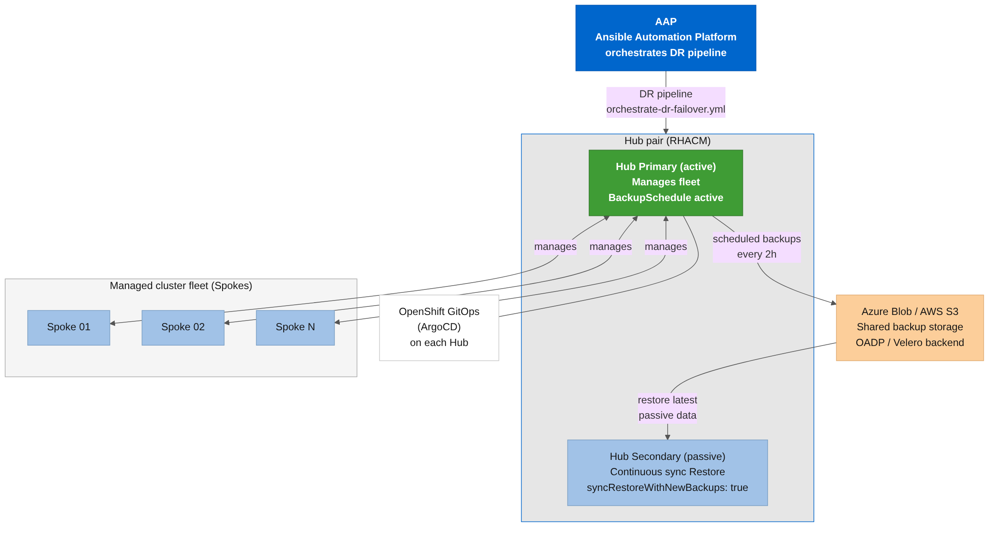
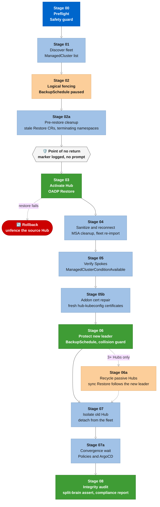
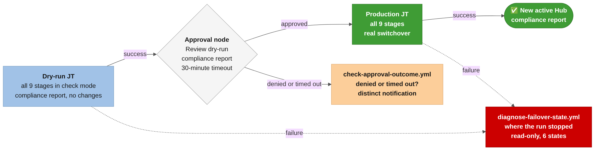
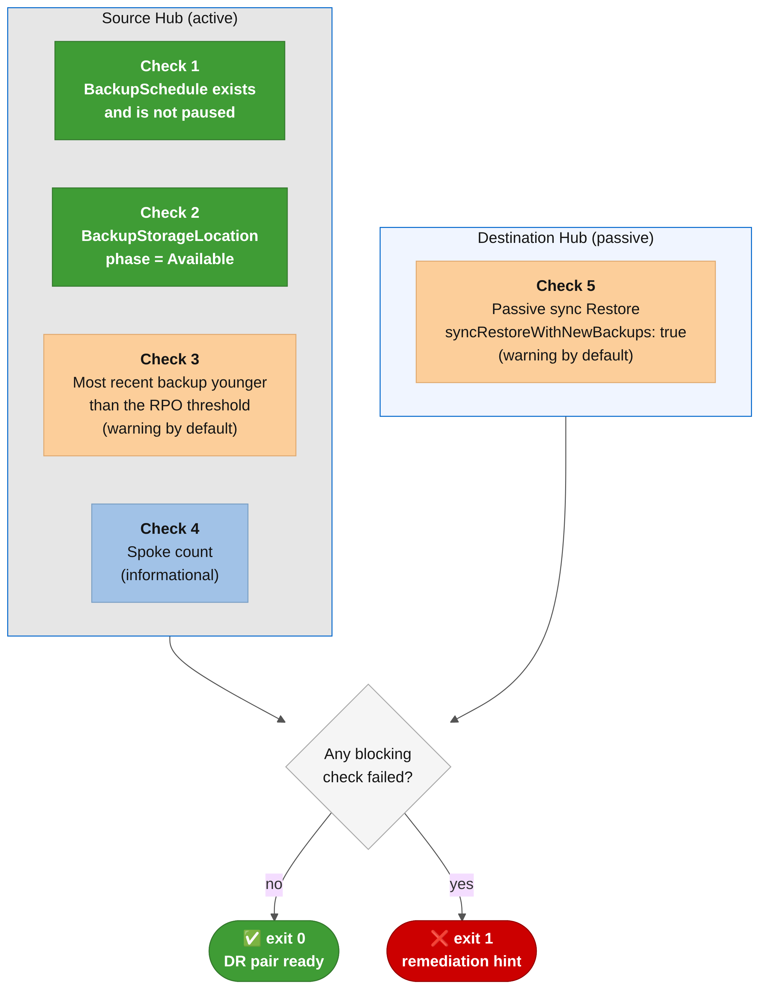
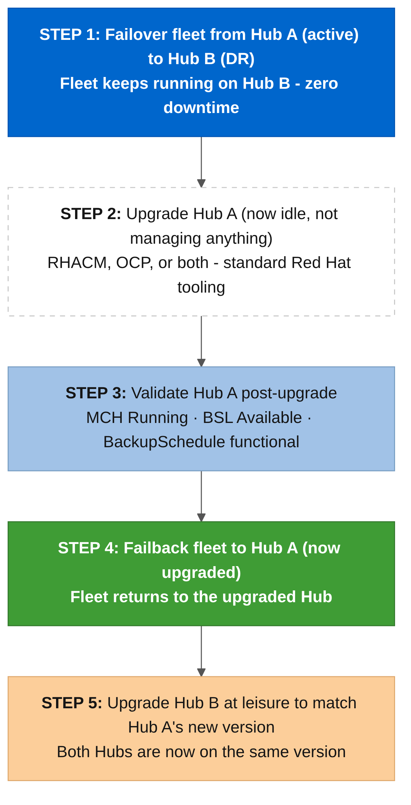

*An Ansible collection that turns Red Hat Advanced Cluster Management Hub disaster recovery into a nine-stage, human-gated pipeline: dry-run rehearsals, split-brain prevention, and zero-downtime Hub upgrades built in.*

If your organization runs **Red Hat Advanced Cluster Management (ACM)** as a Hub controlling a fleet of managed clusters, you eventually have to answer an uncomfortable question: **what happens when the Hub itself goes down?** ACM ships an active/passive Business Continuity model backed by OADP and Velero, but wiring that into something an on-call engineer can run safely at 3 a.m., with an audit trail and a rehearsal path, is left as an exercise for the reader. In most shops today that exercise is a runbook: a wiki page full of **`oc`** commands copy-pasted under pressure, no built-in dry-run, and no way to tell a denied approval from a timeout after the fact.

I built an Ansible collection to close that gap. It wraps ACM's Business Continuity APIs (**`BackupSchedule`**, **`Restore`**, **`ManagedServiceAccount`**) into a nine-stage failover/failback pipeline that runs behind an AAP approval gate, adds a read-only readiness check, and handles the post-restore problems I hit while running failovers against real clusters in my lab. The collection is called **`dfmateus.acm_dr`**.

- 📦 **Ansible Galaxy:** **`ansible-galaxy collection install dfmateus.acm_dr`**
- 🔗 **GitHub Repository:** [dfmateus/acm_dr](https://github.com/dfmateus/acm_dr)

> ⚡ **TL;DR:**
>
> **The Problem:** RHACM Hub disaster recovery today is a manual runbook: no rehearsal, no split-brain detection, no way to distinguish a denied approval from a timeout.
>
> **The Solution:** A 9-stage failover/failback pipeline with dry-run rehearsals against real clusters, a human approval gate in AAP between the rehearsal and the real run, and built-in handling for post-restore problems that only show up on real clusters.
>
> **The Impact:** Failover and failback from one playbook (about 10 minutes end to end in my lab), monthly DR drills that change nothing, and zero-downtime Hub upgrades by failing over instead of taking the fleet offline.

> 🔗 **Part of the [ACM Multi-Cluster Automation](https://dfmateus.github.io/series/acm-multi-cluster-automation/) series.** This post covers Hub-level DR. Part 1, [Zero Static Tokens: Automating Multi-Cluster Credentials with Ansible and ACM](https://dfmateus.github.io/post/zero-static-tokens-acm-spoke/), introduced **`dfmateus.acm_spoke`** and short-lived credentials for Spoke clusters. This collection doesn't use that model yet. The identity section below explains why, and what changes in 1.1.

## 🚨 The problem: disaster recovery as a runbook, not a system

RHACM's Business Continuity model is straightforward on paper: one active Hub takes scheduled backups to shared storage, one or more passive Hubs continuously restore the latest backup, and if the active Hub dies, you promote a passive Hub and reconnect the fleet. The gap is everything between "promote a passive Hub" and an operator actually doing it safely, under time pressure, without an existing automation platform in place.



**Architecture Breakdown:**

- **1. AAP as the Orchestration Layer:** Ansible Automation Platform runs the DR pipeline as Job Templates and Workflow Job Templates, not ad-hoc shell sessions on someone's laptop.
- **2. Hub Pair Sharing Backup Storage:** The active Hub manages the fleet and writes scheduled backups every 2 hours; the passive Hub continuously restores the latest backup (**`syncRestoreWithNewBackups: true`**) so it is always warm.
- **3. GitOps Runs Independently on Each Hub:** OpenShift GitOps (ArgoCD) is installed per Hub and reconciles from Git after a failover, instead of being backed up and restored as cluster state.

> **🚨 The Operational Cost of Manual DR**
>
> Without automation, a Hub failover means an operator manually pausing the **`BackupSchedule`**, watching a **`Restore`** custom resource, patching stale **`ManagedServiceAccount`** secrets by hand, and detaching the old Hub, all while the fleet is unmanaged. Rehearsing this safely, without touching production state, is rarely done in practice.

## ⚙️ The solution: a 9-stage failover/failback pipeline

The core of the collection is **`acm_dr_failover_manager`**, a role that drives failover and failback through the same nine-stage pipeline. Stage 02 fences the old Hub, and everything from Stage 03 on changes which Hub is in charge, so that boundary is where the pipeline marks its point of no return.



**Pipeline Stage Breakdown:**

- **Stage 00, Preflight:** Safety guard checks (credentials, RHACM/OCP version compatibility) before anything touches cluster state.
- **Stage 01, Discover fleet:** Reads the current **`ManagedCluster`** list from the source Hub.
- **Stage 02, Logical fencing:** Pauses the source Hub's **`BackupSchedule`**. This is the last fully reversible step.
- **Stage 02a, Pre-restore cleanup:** Removes stale **`Restore`** CRs and terminating namespaces on the destination Hub.
- **Point of no return:** The run logs an explicit marker before Stage 03, so the job output shows where the irreversible part began. The human decision happens before the run, not here (more on that below).
- **Stage 03, Restore:** Activates the destination Hub via OADP **`Restore`**, with an automatic rollback (unfencing the source Hub) if the restore fails.
- **Stage 04, Sanitize and reconnect:** Deletes every **`ManagedServiceAccount`** that came back from the restore with **`TokenReported=False`**, together with its token Secret, then re-imports the fleet. Spokes it still can't reach get reconnected with break-glass ServiceAccount tokens mirrored to the Hub at onboarding. The restore problems behind this stage are the subject of the next post in this series.
- **Stage 05b, Addon cert repair:** Deletes and recreates **`ManagedClusterAddons`** so the destination Hub's CA issues fresh certificates. Without this, addon agents receive **HTTP 401** because their **`hub-kubeconfig`** is still signed by the source Hub's CA (**`04b_repair_addon_certs.yml`**).
- **Stages 05-06, Verify and protect:** Polls spokes until **`ManagedClusterConditionAvailable=True`**, then enables the **`BackupSchedule`** on the new leader. If the storage still carries backups from the prior leader (expected after failback), Stage 06 detects the **`BackupCollision`** state and resolves it automatically. Backups are identified by the source Hub's **`ClusterVersion`** UID and **`backup-cluster`** label, not by a bare "latest" tag, preventing cross-Hub confusion when two Hub pairs share the same storage account.
- **Stages 07-08, Isolate and audit:** Detaches the old Hub from the fleet and produces a compliance report of the whole run.

In my August lab runs, a full production failover took about 10 minutes from preflight to the compliance report. With three or more Hubs, Stage 06a also recycles the sync **`Restore`** on every remaining passive Hub, so they start following the new leader's backups without anyone touching them.

> **⛔ The Point of No Return**
>
> Everything before Stage 03 (preflight, discovery, fencing, cleanup) is safe to abort. Everything after it activates a new Hub as the fleet's source of truth. The role does not stop and prompt at that boundary, because interactive prompts don't work reliably inside AAP jobs. The human gate lives in the AAP workflow instead, as an approval node that follows a full dry-run. On the CLI nothing stops the run once it starts, so run it with **`acm_dr_failover_manager_dry_run=true`** first and read the report before the real one.

## 🧠 Split-brain prevention and safe rehearsal

Failover pipelines fail in interesting ways: a restore that hangs, an approval that times out instead of being denied, or, worst case, two Hubs that both believe they are active at once. The collection catches that last one in Stage 08. It reads the **`BackupSchedule`** on the old Hub, the new Hub and every additional passive Hub, and counts how many are active. More than one means two Hubs are writing backups to the same storage. The assert fails the run as a hard error, not a warning, and the compliance report names the Hub whose schedule needs pausing.

When a run fails partway through, **`diagnose-failover-state.yml`** tells you where it stopped. It is read-only, runs as the failure branch of the AAP workflows, and sorts the Hub pair into one of six states, from "failover did not start" to "failover completed but post-restore stages failed".

Every stage in the pipeline also supports Ansible's **`check_mode`** and **`--diff`**, so **`acm_dr_failover_manager_dry_run=true`** runs the entire nine-stage logic **against real clusters**, reading actual **`BackupSchedule`**, **`Restore`**, and **`ManagedCluster`** state, without mutating anything. That is a materially different guarantee than testing against a mock: a dry-run tells you whether ***your* topology is ready today**, not whether the code compiles.

## 👤 Human in the loop: approval gates in AAP

In AAP, the Hub Switchover workflow puts the human decision after a full rehearsal, before anything has changed on either Hub.



**Approval Workflow Breakdown:**

- **1. Dry-run JT (all 9 stages):** Runs the whole pipeline in check mode against the live Hubs and prints the compliance report. Nothing is mutated, so the source Hub is still the active one.
- **2. Approval node, "Review dry-run compliance report":** An operator reads the report in the previous job's output and approves or denies. The node times out after 30 minutes.
- **3. Production JT (all 9 stages):** Runs only if approved, and performs the real switchover. A denial or a timeout goes to **`check-approval-outcome.yml`** instead, and a failure in either job goes to **`diagnose-failover-state.yml`**.

A denied approval and a timed-out approval mean very different things operationally: **a denial means someone actively said no**, **a timeout means nobody was reachable in the window**. But AAP's failure branch treats both the same by default. The collection ships **`check-approval-outcome.yml`** to tell them apart: it queries the AAP Controller API for the parent workflow job, walks its **`workflow_nodes`** to find the approval node, and reads **`timed_out`** straight from the node's job summary. It then sends a distinct Slack, Teams, or generic webhook notification depending on which one actually happened, so on-call doesn't have to guess.

The webhook system is opt-in and covers more than approval outcomes: the pipeline also notifies on **`BackupCollision`** detection, on Spokes reconnected through mirrored tokens (or left for manual reconnection), and on missing or expired credentials. You configure it with the **ACM DR - Notification Webhook** credential type, which takes a **`webhook_url`** and a **`webhook_format`**: **`slack`**, **`teams`** (an Adaptive Card) or **`generic-json`** for anything else that accepts an HTTP POST.

## 🔑 How the automation authenticates, and where it differs from Part 1

[Part 1](https://dfmateus.github.io/post/zero-static-tokens-acm-spoke/) made the case against permanent **`cluster-admin`** tokens stored per cluster in AAP. Version 1.0 of this collection still uses that model, and you should know that before you install it.

Every Hub and Spoke gets an **`ansible-dr-orchestrator`** ServiceAccount in the **`ansible-automation`** namespace, bound through a **`ClusterRoleBinding`** to **`cluster-admin`** by default. The **`acm_dr_cluster_onboard_cluster_role`** variable lets you point it at a narrower **`ClusterRole`**. A long-lived token Secret backs one AAP credential per cluster, so every action in a job log traces back to one identity instead of a shared kubeadmin session, and **`bootstrap-cluster.yml`** registers that credential through the Controller API, so nobody hand-copies a token into the UI.

For the Hubs there's a solid reason for this design: DR writes to both of them, and a Hub can't borrow its credential from the Hub that just failed. For the Spokes the reason is weaker. Short-lived tokens minted through **`acm_spoke`** would cover everything except the one moment when the old Hub is gone and a Spoke has to be reconnected. Version 1.1 moves Spoke access to **`acm_spoke`** and keeps a permanent per-Spoke token only as a break-glass path for that reconnection. That change will get its own post.

## 🩺 DR readiness drills: a health check you can run anytime

**`check-dr-readiness.yml`** is a read-only playbook that answers **"is this DR pair actually ready to fail over right now?"** without touching any state, so it is safe to run on a schedule, in CI, or as an AAP cron job.



**Readiness Check Breakdown:**

- **Checks 1-2, Backup health:** Confirms the source Hub's **`BackupSchedule`** exists and is not paused, and that its **`BackupStorageLocation`** reports **`Available`**.
- **Check 3, RPO threshold:** Compares the age of the most recent backup with **`acm_dr_readiness_check_rpo_seconds`** (default **`25200`**, 7 hours). A stale backup is a warning by default; set **`acm_dr_readiness_check_fail_on_stale_backup=true`** to make it fail the check.
- **Check 4, Spoke count:** An informational, non-blocking count of managed clusters, useful for catching silent fleet shrinkage.
- **Check 5, Passive sync:** Confirms the destination Hub's **`Restore`** CR is configured with **`syncRestoreWithNewBackups: true`**, so it is actually staying warm. A missing **`Restore`** is also a warning by default, controlled by **`acm_dr_readiness_check_fail_on_missing_restore`**.

The playbook exits **`0`** when every blocking check passes and **`1`** with a specific remediation hint when one fails, which is the contract a monitoring system or an AAP schedule with a notification attached needs.

## 🔄 Zero-downtime Hub upgrades: turning failover into a maintenance tool

One of the more useful side effects of having a reliable failover pipeline: you can use it to upgrade a Hub without ever taking the fleet offline. The collection calls this **Planned Maintenance Failover**.



**Zero-Downtime Upgrade Breakdown:**

- **Step 1, Failover to the DR Hub:** The fleet keeps running, now managed by Hub B, while Hub A sits idle.
- **Step 2, Upgrade the idle Hub:** Standard Red Hat tooling: an OLM channel switch for RHACM first (to expand the supported OCP range), then **`oc adm upgrade`** for OCP.
- **Step 3, Validate:** **`check-dr-readiness.yml`** confirms the upgraded Hub A has **`MCH`** running, its **`BackupStorageLocation`** available, and its **`BackupSchedule`** functional again.
- **Step 4, Failback:** The fleet returns to Hub A, now upgraded, with zero downtime.
- **Step 5, Upgrade Hub B at leisure:** No pressure, since the fleet isn't depending on Hub B anymore.

This is the same **`orchestrate-dr-failover.yml`** playbook used for a real incident, just invoked twice with **`acm_dr_failover_manager_allow_fenced_origin=true`** on the way back. There is **no separate "upgrade mode"** to maintain.

## 📋 The collection at a glance

**Collection Structure Breakdown (all 11 roles):**

| Role | What it does |
| --- | --- |
| **`acm_dr_failover_manager`** | The 9-stage failover/failback engine covered above |
| **`acm_dr_readiness_check`** | Read-only pre-failover health gate (5 checks) |
| **`acm_dr_hub_setup`** / **`acm_dr_hub_cleanup`** | Provision and decommission Hub DR infrastructure |
| **`acm_dr_spoke_manager`** | Distribution-agnostic spoke onboarding, and graceful detach with the cleanup steps from [KCS 5950901](https://access.redhat.com/solutions/5950901) |
| **`acm_dr_cluster_onboard`** | Bootstraps the automation ServiceAccount and self-registers its AAP credential |
| **`acm_dr_msa_provisioner`** | Optional, off by default: provisions a ManagedServiceAccount per Spoke for short-lived access |
| **`acm_dr_upgrade_manager`** | Drives the RHACM OLM channel upgrade used in Planned Maintenance Failover |
| **`acm_argocd_instance_setup`** / **`_cleanup`** | Provisions and tears down parametric GitOps instances per Hub |
| **`acm_dr_kubeconfig_resolver`** | Shared pre-task role every playbook uses to build its runtime kubeconfig from AAP credential injection |

> 🧪 **Validated, Not Just Tested**
>
> The collection ships **188 end-to-end test cases**, spanning 13 validation phases and three AAP integration rounds, run between August 3 and August 24, 2026 against real clusters across **four cloud providers**, with no mocks: ARO and AKS on Azure, ROSA HCP and EKS on AWS, GKE on Google Cloud, and IKS on IBM Cloud. All 11 roles carry full **`argument_specs`**, and **`ansible-lint --profile production`** passes clean across all **255 files** in the collection (tasks, playbooks, Jinja2 templates, and role metadata). The repository also ships a runbook decision tree (**`docs/runbook/`**) covering the failure modes an on-call operator is actually likely to hit: stuck Stage 03 restores, **`BackupCollision`** states, expired ServiceAccount tokens, and the **`TokenReportFailed`** condition some restores leave behind.

## 🧰 What else ships in **`examples/`**

The **`examples/`** directory is optional. It's there for teams that want to go from zero to a working DR lab with full AAP integration in one pass:

- **AAP configuration as code:** 12 YAML files for **`infra.controller_configuration`**, covering 8 credential types, 13 Job Templates, 5 Workflow Job Templates (including the approval-gated Hub Switchover), schedules and notifications.
- **Execution Environment:** an **`execution-environment.yml`** based on **`ee-minimal-rhel9:2.17`**, with **`oc`**, **`kubectl`**, **`jq`**, **`kubernetes.core`** and the Azure and AWS Python SDKs.
- **MCP:** read-only AI assistant access to the DR jobs through the AAP MCP server, [generally available since the June 3, 2026 release](https://docs.redhat.com/en/documentation/red_hat_ansible_automation_platform/2.7/extend-con_about_ansible_mcp_server) on AAP 2.6 and later. The assistant can read the approval nodes, but it can't approve them.
- **Terraform:** **`.tfvars.example`** files for an ARO-based lab with two Hubs and a Spoke, built on the [terraform-aro](https://github.com/rh-mobb/terraform-aro) project from Red Hat Cloud Experts.
- **Scripts and RBAC:** break-glass cleanup for stuck finalizers, onboarding helpers, an interactive DR wrapper, an offline test suite for the compliance report (8 mock scenarios), and the RBAC manifest for the **`ansible-dr-orchestrator`** ServiceAccount.

## ⚠️ Limitations and known constraints

**⚙️ Prerequisites:**

- **RHACM:** 2.10 through 2.17 on both Hubs, validated on **RHACM 2.17** in August 2026. Later 2.17 z-streams haven't been retested yet, and the preflight version gate blocks newer releases until they are.
- **AAP:** 2.7 or later for the full CasC and Workflow integration, or **`ansible-core >= 2.16`** for CLI-only execution.
- **OADP:** Installed and configured with a shared **`BackupStorageLocation`** accessible by both Hubs.
- **ansible-builder:** Required only if building the custom Execution Environment.

**What's not covered yet:**

- **No confirmation on the CLI:** a production run goes from preflight to Hub activation without stopping, so rehearse with **`acm_dr_failover_manager_dry_run=true`** first. Version 1.1 adds an explicit confirmation variable.
- **Permanent Spoke credentials:** covered in the identity section above. Version 1.1 moves Spoke access to **`acm_spoke`**.
- **Molecule coverage:** Currently limited to a single offline scenario; broader Molecule coverage is next on the roadmap.
- **ROSA HCP storage:** Uses the generic AWS S3 path today, without STS-specific handling.
- **No automatic rollback past Stage 06:** Stage 03's restore failure rolls back automatically (unfencing the source Hub), but a failure in Stage 07 or 08 (after the new Hub is already protecting the fleet) requires manual intervention, by design, since automatically undoing an isolation step is riskier than leaving it for an operator to review.

## 🏁 Wrap up

The collection is at **version 1.0.0**: 11 roles, 12 playbooks, validated end-to-end against real multi-cloud clusters. Everything in this post covers DR at the Hub level, backing up and restoring the RHACM control plane itself. The roadmap builds outward from there:

- **v1.1:** Spoke access through **`acm_spoke`**, an explicit confirmation for production runs on the CLI, and validation on the newest RHACM release.
- **v1.2:** More storage backends (MinIO, GCS, generic S3) and automated DR drills with RTO/RPO reporting.
- **v1.3:** Submariner cross-cluster connectivity and the ODF Multicluster Orchestrator foundation.
- **v2.0:** Application-level DR through ODF, Ramen, and **`DRPlacementControl`**, so failover stops being a Hub-only concept and starts covering the workloads running on top of it.

**Next in the series:** what broke after Hub restores in my lab, and how the pipeline handles each case.

📖 **Getting started?** Follow the [step-by-step onboarding guide](https://github.com/dfmateus/acm_dr/blob/main/docs/onboarding/getting-started.md) from collection install to your first failover.

✅ **Official compliance:** The automation is [validated field-by-field](https://github.com/dfmateus/acm_dr/blob/main/docs/architecture/official-compliance.md) against the RHACM 2.17 Business Continuity documentation.

🤔 **Ready to stop treating Hub disaster recovery as a runbook?**

🚀 Grab the collection from Ansible Galaxy or check out the playbooks, architecture, and CasC examples on GitHub:

```bash
ansible-galaxy collection install dfmateus.acm_dr
```

- 🔗 **GitHub Repository:** [https://github.com/dfmateus/acm_dr](https://github.com/dfmateus/acm_dr)

*Contributions, issues, and feature requests are welcome!*
